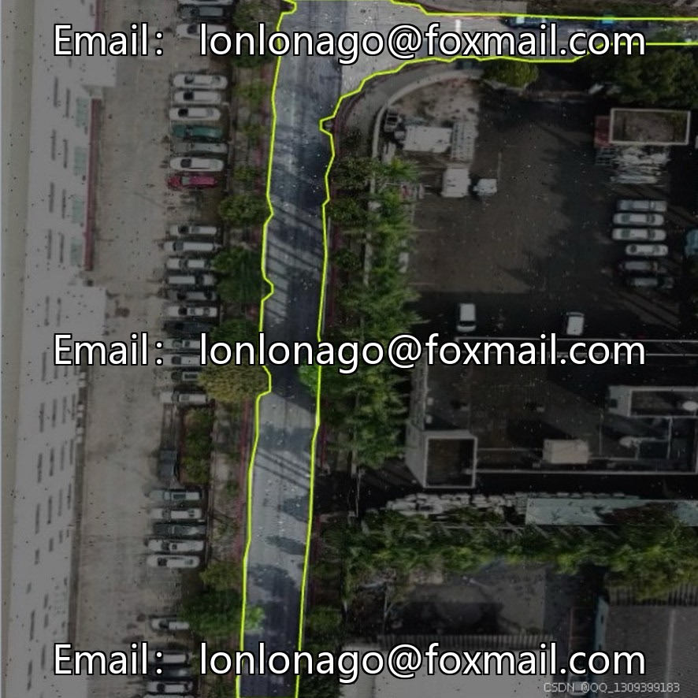
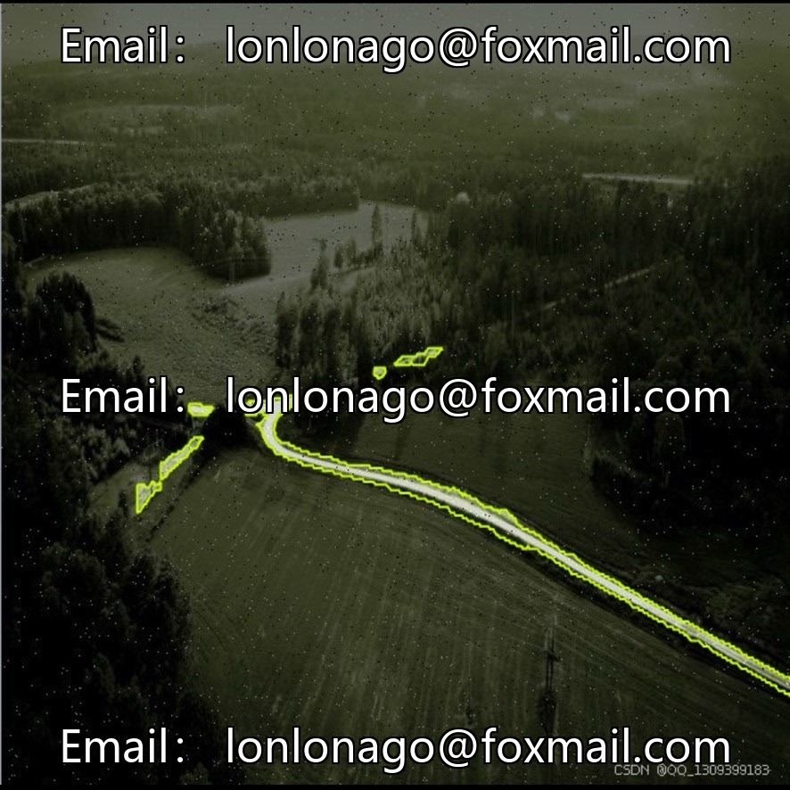
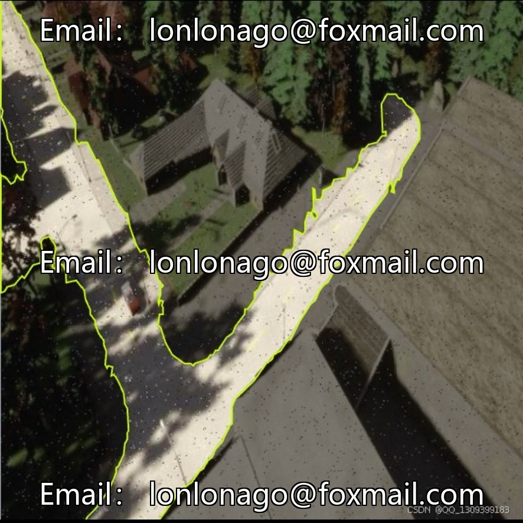
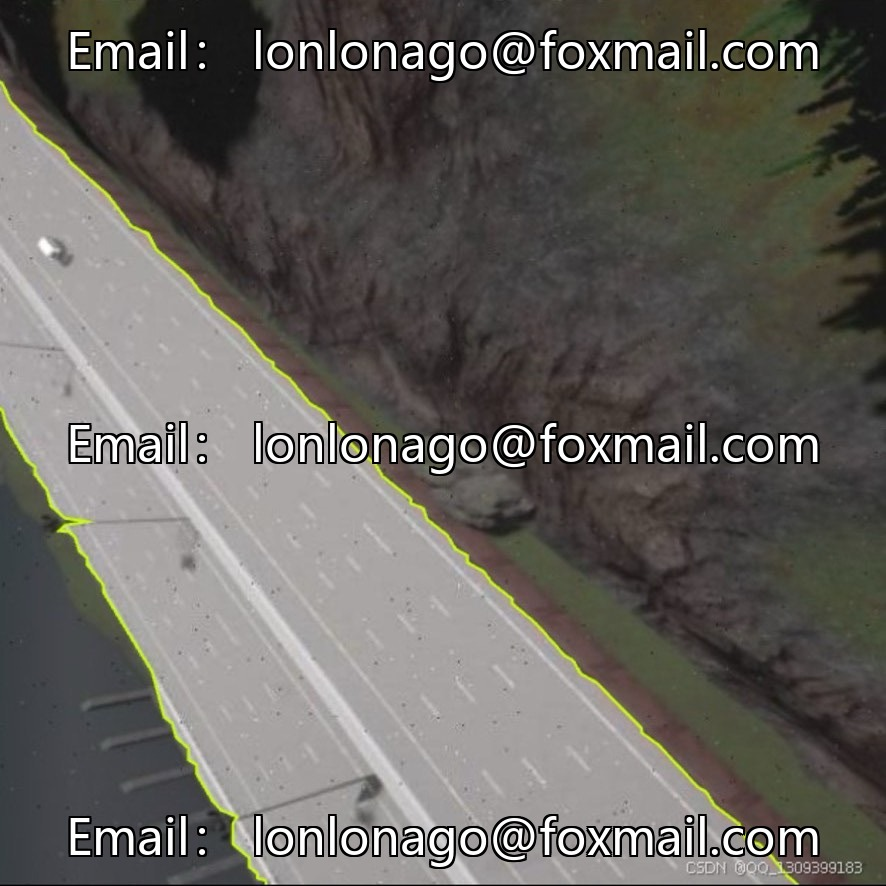
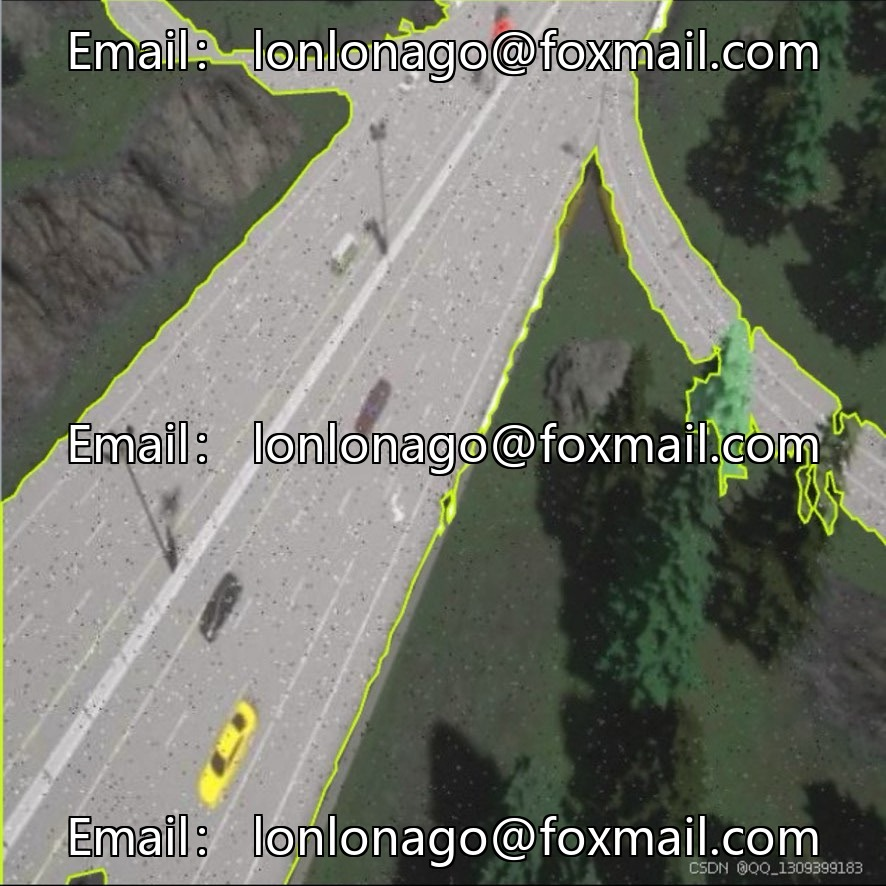

# Aerial Vehicle-Based Road Semantic Segmentation Dataset | Issue 10032

## Body

UAV Road Semantic Segmentation Dataset | Issue 10032
A drone-viewpoint road pixel-level segmentation dataset for UAVs, comprising 9803 images, split into training set (9017 images, 92%), validation set (269 images, 2.7%), and test set (517 images, 5.3%) in proportions. The scene types are uniform, with increasing difficulty levels.

The annotation system is binary segmentation: road-segmentation (road) + background (background). It uses polygon coordinates to precisely outline the road contours. Some annotations are labeled as "real" indicating real-scene acquisition. The system provides COCO format and polygon annotation files, compatible with various segmentation algorithms, facilitating secondary development.

Images are uniformly sized at 640×640, in JPG format, balancing lane line details with training computational power. Complete metadata and image hash values are included for version management and data verification.

Applicable to scenarios such as autonomous driving area identification, urban aerial traffic monitoring, remote sensing map automatic updates, park inspection robot visual navigation, and post-disaster road traffic assessment.

Virtual materials, once sold, are non-refundable.
Interested friends, click "I want" to proceed.

## Images

## Payment

Here is a pay link on Stripe ( https://buy.stripe.com/3cs8yP7sY87d0vu9AB ). Please contact me lonlonago@foxmail.com after funding $89, and I will send you a complete data files , thank you!

